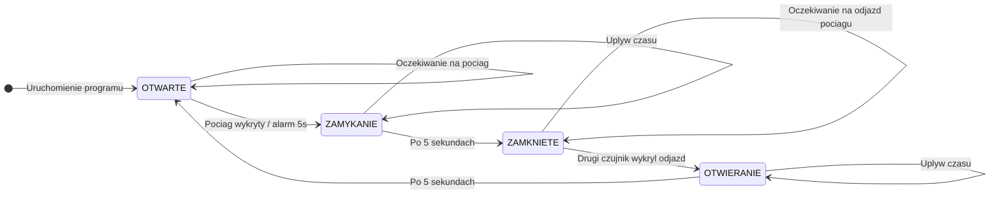
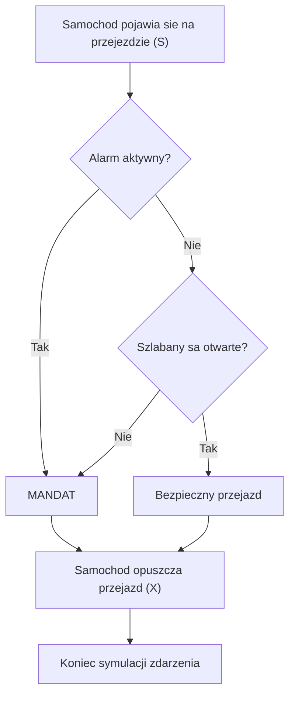

# 🚧 Automatyczny przejazd kolejowy – maszyna stanów

Projekt edukacyjny realizowany w języku **C++** z wykorzystaniem środowiska **Code::Blocks**.

Celem projektu jest stworzenie symulatora automatycznego przejazdu kolejowego, który wykorzystuje czujniki ruchu do wykrywania nadjeżdżającego i oddalającego się pociągu oraz steruje szlabanami i sygnalizacją alarmową.

Sterowanie przejazdem zostało oparte na koncepcji **maszyny stanów (Finite State Machine – FSM)** oraz programowaniu obiektowym z wykorzystaniem klas.

## 📌 1. Opis projektu

Projekt symuluje działanie automatycznego przejazdu kolejowego.

Pociąg porusza się z określoną prędkością i po osiągnięciu pierwszego czujnika uruchamia procedurę zamykania przejazdu.

System realizuje następujące zadania:

- Wykrywanie nadjeżdżającego pociągu za pomocą pierwszego czujnika.
- Uruchomienie alarmu dźwiękowego na 5 sekund.
- Automatyczne opuszczanie szlabanów.
- Wykrywanie samochodu znajdującego się na przejeździe.
- Wyświetlanie komunikatu `MANDAT`, jeżeli samochód pojawi się podczas aktywnego alarmu lub gdy szlabany nie są całkowicie otwarte.
- Wykrywanie oddalającego się pociągu za pomocą drugiego czujnika.
- Automatyczne podnoszenie szlabanów po przejechaniu pociągu.

Całość działa w konsoli, a pojawienie się samochodu jest symulowane za pomocą klawiatury.

## 🔧 2. Wykorzystane technologie i rozwiązania

| Element | Zastosowanie |
| --- | --- |
| C++ | Główny język programowania |
| Code::Blocks | Środowisko programistyczne |
| Klasy i obiekty | Podział programu na niezależne elementy |
| `enum` | Definiowanie stanów szlabanów |
| `chrono` | Odmierzanie czasu |
| `conio.h` | Odczytywanie klawiszy bez zatrzymywania programu |
| `thread` | Krótkie opóźnienie pętli symulacji |
| `bool` | Przechowywanie informacji o stanie alarmu i samochodu |

## 🏗️ 3. Struktura programu – klasy

Program został podzielony na cztery główne klasy.

| Klasa | Odpowiedzialność |
| --- | --- |
| `Pociag` | Symulacja ruchu pociągu, przechowywanie pozycji i prędkości |
| `Czujniki` | Wykrywanie pociągu przed przejazdem i za przejazdem |
| `Szlabany` | Sterowanie otwieraniem i zamykaniem szlabanów |
| `Przejazd` | Zarządzanie alarmem, samochodem i działaniem przejazdu |

### Klasa `Pociag`

Odpowiada za symulację ruchu pociągu.

Przechowuje:

- `pozycja` – aktualna odległość pociągu od przejazdu.
- `predkosc` – prędkość poruszania się pociągu.

Najważniejsze funkcje:

- `aktualizuj()` – aktualizuje pozycję pociągu na podstawie upływu czasu.
- `getPozycja()` – zwraca aktualną pozycję pociągu.
- `getPredkosc()` – zwraca prędkość pociągu.

### Klasa `Czujniki`

Odpowiada za symulację dwóch czujników ruchu.

- `sprawdzPierwszy()` – wykrywa pociąg w odległości 200 metrów przed przejazdem.
- `sprawdzDrugi()` – wykrywa pociąg w odległości 50 metrów za przejazdem.

Każdy czujnik wykrywa pociąg tylko raz podczas jednej symulacji.

### Klasa `Szlabany`

Odpowiada za sterowanie szlabanami za pomocą maszyny stanów.

Najważniejsze funkcje:

- `zamknij()` – rozpoczyna opuszczanie szlabanów.
- `otworz()` – rozpoczyna podnoszenie szlabanów.
- `aktualizuj()` – sprawdza upływ czasu i zmienia stan szlabanów.
- `getStan()` – zwraca aktualny stan szlabanów.
- `getNazwaStanu()` – zwraca nazwę aktualnego stanu.

### Klasa `Przejazd`

Jest główną klasą odpowiedzialną za obsługę przejazdu kolejowego.

Przechowuje:

- `alarm` – informację, czy alarm jest aktywny.
- `samochod` – informację, czy samochód znajduje się na przejeździe.
- `szlabany` – obiekt klasy `Szlabany`.

Najważniejsze funkcje:

- `wlaczAlarm()` – uruchamia alarm na 5 sekund.
- `samochodWjechal()` – symuluje pojawienie się samochodu i sprawdza, czy należy wyświetlić mandat.
- `samochodWyjechal()` – symuluje opuszczenie przejazdu przez samochód.
- `rozpocznijZamykanie()` – rozpoczyna zamykanie szlabanów.
- `rozpocznijOtwieranie()` – rozpoczyna otwieranie szlabanów.
- `aktualizuj()` – aktualizuje alarm i szlabany.

## ⚙️ 4. Zasada działania

System wykorzystuje dwa czujniki rozmieszczone po obu stronach przejazdu.

### Wykrycie nadjeżdżającego pociągu

1. Pociąg porusza się w kierunku przejazdu z określoną prędkością.
2. Po osiągnięciu odległości 200 metrów pierwszy czujnik wykrywa pociąg.
3. Uruchamiany jest alarm trwający 5 sekund.
4. Po zakończeniu alarmu rozpoczyna się opuszczanie szlabanów.
5. Po kolejnych 5 sekundach szlabany osiągają pozycję zamkniętą.

### Wykrycie samochodu na przejeździe

Samochód jest symulowany za pomocą klawisza `S`.

Po jego naciśnięciu program sprawdza aktualną sytuację na przejeździe.

Jeżeli:

- alarm jest aktywny,
- szlabany się zamykają,
- szlabany są zamknięte,
- szlabany się otwierają,

wyświetlany jest komunikat:

`MANDAT!`

Jeżeli alarm jest wyłączony, a szlabany są całkowicie otwarte, samochód może przejechać bezpiecznie.

### Wykrycie oddalającego się pociągu

1. Pociąg przejeżdża przez przejazd kolejowy.
2. Po oddaleniu się o 50 metrów za przejazd drugi czujnik wykrywa pociąg.
3. System rozpoczyna podnoszenie szlabanów.
4. Szlabany podnoszą się przez 5 sekund.
5. Po zakończeniu ruchu przejazd jest ponownie otwarty.

## 🎮 5. Sterowanie symulatorem

Program umożliwia interakcję za pomocą klawiatury.

| Klawisz | Działanie |
| --- | --- |
| `S` | Symulacja pojawienia się samochodu na przejeździe |
| `X` | Symulacja opuszczenia przejazdu przez samochód |
| `Q` | Zakończenie programu |

Pociąg porusza się automatycznie, bez konieczności sterowania jego ruchem przez użytkownika.

## 🔄 6. Diagram maszyny stanów

Poniższy diagram przedstawia cztery podstawowe stany szlabanów oraz przejścia pomiędzy nimi.

mermaid

### Dodatkowa logika alarmu i samochodu

Alarm oraz samochód są obsługiwane niezależnie od maszyny stanów szlabanów.

mermaid

## 💻 7. Wykorzystane rozwiązania programistyczne

W projekcie zastosowano:

- `class` – tworzenie klas i organizacja kodu.
- `private` – ukrywanie danych wewnątrz klas.
- `public` – udostępnianie funkcji klas.
- Konstruktor – inicjalizacja obiektów.
- `enum` – definiowanie stanów maszyny stanów.
- `switch` – obsługa poszczególnych stanów.
- `bool` – przechowywanie informacji o aktywności alarmu i obecności samochodu.
- `chrono` – odmierzanie czasu bez blokowania programu.
- `steady_clock` – pomiar upływu czasu.
- `duration` – obliczanie czasu pomiędzy zdarzeniami.
- `kbhit()` – sprawdzanie, czy użytkownik nacisnął klawisz.
- `getch()` – odczytywanie klawisza bez konieczności zatwierdzania Enterem.
- `switch(state)` – wybór aktualnego stanu maszyny.
- `this_thread::sleep_for()` – ograniczenie częstotliwości wykonywania pętli symulacji.

## ⏱️ 8. Parametry projektu

| Parametr | Wartość |
| --- | --- |
| Początkowa odległość pociągu | 250 m |
| Prędkość pociągu | 20 m/s |
| Odległość pierwszego czujnika | 200 m przed przejazdem |
| Odległość drugiego czujnika | 50 m za przejazdem |
| Czas trwania alarmu | 5 sekund |
| Czas zamykania szlabanów | 5 sekund |
| Czas otwierania szlabanów | 5 sekund |
| Częstotliwość aktualizacji pętli | 50 ms |
| Symulacja samochodu | Klawisz S |
| Symulacja wyjazdu samochodu | Klawisz X |

## 🎯 9. Cel edukacyjny projektu

Projekt pozwala zapoznać się z praktycznym zastosowaniem programowania obiektowego oraz maszyn stanów w języku C++.

Najważniejsze zagadnienia poznane podczas realizacji projektu:

- Projektowanie klas i tworzenie obiektów.
- Hermetyzacja danych z wykorzystaniem `private` i `public`.
- Wykorzystanie typów wyliczeniowych `enum`.
- Projektowanie maszyny stanów FSM.
- Obsługa zdarzeń w czasie rzeczywistym.
- Odmierzanie czasu bez blokowania programu.
- Współpraca kilku obiektów w ramach jednego systemu.
- Symulowanie działania czujników i urządzeń automatyki.

