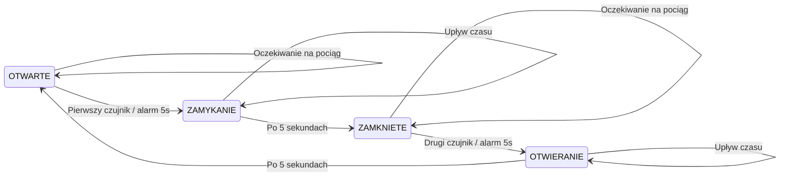
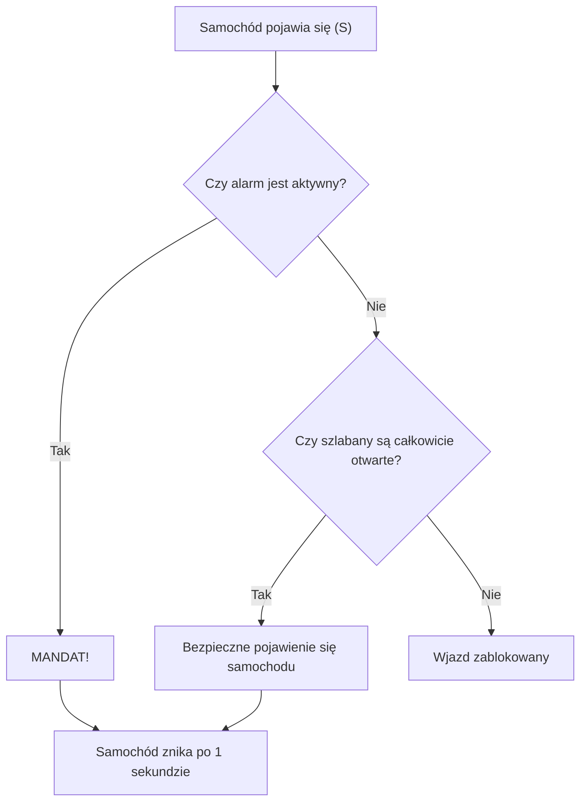

# 🚧 Automatyczny przejazd kolejowy – maszyna stanów

Projekt edukacyjny realizowany w języku **C++** z wykorzystaniem środowiska **Code::Blocks**.

Celem projektu jest stworzenie symulatora automatycznego przejazdu kolejowego, który wykorzystuje czujniki do wykrywania nadjeżdżającego i oddalającego się pociągu oraz automatycznie steruje szlabanami i sygnalizacją alarmową.

Sterowanie przejazdem zostało oparte na koncepcji **maszyny stanów (Finite State Machine – FSM)** oraz programowaniu obiektowym z wykorzystaniem klas.

## 📌 1. Opis projektu

Projekt symuluje działanie automatycznego przejazdu kolejowego.

Pociąg porusza się z określoną prędkością. Po wykryciu go przez pierwszy czujnik uruchamiany jest alarm ostrzegawczy, który trwa 5 sekund. Następnie rozpoczyna się zamykanie szlabanów.

Po przejechaniu pociągu i wykryciu go przez drugi czujnik system rozpoczyna otwieranie szlabanów oraz ponownie uruchamia alarm na 5 sekund.

System realizuje następujące zadania:

- Automatyczne poruszanie się pociągu.
- Wykrywanie nadjeżdżającego pociągu za pomocą pierwszego czujnika.
- Uruchamianie alarmu na 5 sekund.
- Automatyczne zamykanie szlabanów po zakończeniu pierwszego alarmu.
- Blokowanie możliwości pojawienia się samochodu, gdy szlabany nie są całkowicie otwarte.
- Wykrywanie samochodu za pomocą klawiatury.
- Wyświetlanie komunikatu `MANDAT`, jeżeli samochód pojawi się podczas aktywnego alarmu.
- Automatyczne wykrywanie oddalającego się pociągu.
- Otwieranie szlabanów i ponowne uruchamianie alarmu po wykryciu pociągu przez drugi czujnik.

Całość działa w konsoli, a pojawienie się samochodu jest symulowane za pomocą klawisza `S`.

## 🔧 2. Wykorzystane technologie i rozwiązania

| Element | Zastosowanie |
| --- | --- |
| C++ | Główny język programowania |
| Code::Blocks | Środowisko programistyczne |
| Klasy i obiekty | Podział programu na niezależne elementy |
| `enum` | Definiowanie stanów szlabanów |
| `chrono` | Odmierzanie czasu |
| `steady_clock` | Dokładny pomiar upływu czasu |
| `conio.h` | Odczytywanie klawiszy bez zatrzymywania programu |
| `thread` | Ograniczenie częstotliwości wykonywania pętli |
| `bool` | Przechowywanie informacji o stanie systemu |

## 🏗️ 3. Struktura programu – klasy

Program został podzielony na pięć głównych klas.

| Klasa | Odpowiedzialność |
| --- | --- |
| `Pociag` | Symulacja ruchu pociągu oraz przechowywanie jego pozycji i prędkości |
| `Czujniki` | Wykrywanie pociągu przed przejazdem i za przejazdem |
| `Szlabany` | Sterowanie otwieraniem i zamykaniem szlabanów |
| `Przejazd` | Zarządzanie alarmem, samochodem i bezpieczeństwem przejazdu |
| `Symulator` | Zarządzanie całą symulacją, czasem, czujnikami i obsługą klawiatury |

### Klasa `Pociag`

Odpowiada za symulację ruchu pociągu.

Przechowuje:

- `pozycja` – aktualna odległość pociągu od przejazdu.
- `predkosc` – prędkość poruszania się pociągu.

Najważniejsze funkcje:

- `aktualizuj()` – aktualizuje pozycję pociągu na podstawie upływu czasu.
- `getPozycja()` – zwraca aktualną pozycję pociągu.
- `getPredkosc()` – zwraca prędkość pociągu.

### Klasa `Czujniki`

Odpowiada za symulację dwóch czujników ruchu.

- `sprawdzPierwszy()` – wykrywa pociąg w odległości 200 metrów przed przejazdem.
- `sprawdzDrugi()` – wykrywa pociąg w odległości 50 metrów za przejazdem.

Każdy czujnik wykrywa pociąg tylko raz podczas jednej symulacji.

### Klasa `Szlabany`

Odpowiada za sterowanie szlabanami za pomocą maszyny stanów.

Wykorzystuje cztery stany:

- `OTWARTE`
- `ZAMYKANIE`
- `ZAMKNIETE`
- `OTWIERANIE`

Najważniejsze funkcje:

- `zamknij()` – rozpoczyna opuszczanie szlabanów.
- `otworz()` – rozpoczyna podnoszenie szlabanów.
- `aktualizuj()` – sprawdza upływ czasu i zmienia stan szlabanów.
- `getStan()` – zwraca aktualny stan szlabanów.
- `getNazwaStanu()` – zwraca tekstową nazwę aktualnego stanu.

### Klasa `Przejazd`

Odpowiada za zarządzanie alarmem, samochodem oraz bezpieczeństwem przejazdu.

Przechowuje:

- `alarm` – informację o aktywności alarmu.
- `samochod` – informację o wykryciu samochodu.
- `szlabany` – obiekt klasy `Szlabany`.

Najważniejsze funkcje:

- `wlaczAlarm()` – uruchamia alarm na 5 sekund.
- `samochodWjechal()` – symuluje pojawienie się samochodu i sprawdza warunki bezpieczeństwa.
- `rozpocznijZamykanie()` – rozpoczyna zamykanie szlabanów.
- `rozpocznijOtwieranie()` – rozpoczyna otwieranie szlabanów.
- `aktualizuj()` – aktualizuje alarm, szlabany i czas wykrywania samochodu.

Samochód jest wykrywany przez jedną sekundę, po czym automatycznie znika z detekcji.

### Klasa `Symulator`

Jest klasą zarządzającą całą symulacją.

Odpowiada za współpracę wszystkich pozostałych klas.

Najważniejsze funkcje:

- `wyswietlMenu()` – wyświetla informacje początkowe.
- `aktualizujPociag()` – aktualizuje pozycję pociągu.
- `obsluzPierwszyCzujnik()` – obsługuje wykrycie nadjeżdżającego pociągu.
- `obsluzZamykanie()` – rozpoczyna zamykanie szlabanów po upływie 5 sekund alarmu.
- `obsluzDrugiCzujnik()` – obsługuje wykrycie oddalającego się pociągu.
- `obsluzKlawiature()` – odczytuje klawisze użytkownika.
- `wyswietlPozycje()` – wyświetla aktualną pozycję pociągu.
- `aktualizuj()` – wykonuje pojedynczy cykl symulacji.
- `uruchom()` – uruchamia główną pętlę programu.

## ⚙️ 4. Zasada działania

System wykorzystuje dwa czujniki rozmieszczone po obu stronach przejazdu.

### Etap 1 – wykrycie nadjeżdżającego pociągu

1. Pociąg rozpoczyna ruch w odległości 250 metrów od przejazdu.
2. Porusza się z prędkością 20 m/s.
3. Po osiągnięciu odległości 200 metrów pierwszy czujnik wykrywa pociąg.
4. Uruchamiany jest alarm trwający 5 sekund.
5. W tym czasie samochód może pojawić się na przejeździe, ale jego pojawienie się powoduje wyświetlenie komunikatu `MANDAT!`.

### Etap 2 – zamykanie szlabanów

1. Po zakończeniu 5-sekundowego alarmu rozpoczyna się opuszczanie szlabanów.
2. Szlabany zamykają się przez kolejne 5 sekund.
3. Po zakończeniu ruchu przechodzą w stan `ZAMKNIETE`.
4. Gdy szlabany się zamykają lub są zamknięte, nie można symulować pojawienia się samochodu na przejeździe.

### Etap 3 – przejazd pociągu

Pociąg kontynuuje ruch przez przejazd kolejowy.

W tym czasie szlabany pozostają zamknięte, a możliwość pojawienia się samochodu jest zablokowana.

### Etap 4 – wykrycie oddalającego się pociągu

1. Pociąg oddala się od przejazdu.
2. Po osiągnięciu odległości 50 metrów za przejazdem drugi czujnik wykrywa pociąg.
3. System rozpoczyna podnoszenie szlabanów.
4. Jednocześnie ponownie uruchamiany jest alarm na 5 sekund.
5. Jeżeli samochód pojawi się podczas aktywnego alarmu, wyświetlany jest komunikat `MANDAT!`.

### Etap 5 – ponowne otwarcie przejazdu

1. Szlabany podnoszą się przez 5 sekund.
2. Po zakończeniu ruchu przechodzą w stan `OTWARTE`.
3. Alarm zostaje wyłączony.
4. Samochody mogą ponownie bezpiecznie korzystać z przejazdu.

## 🚗 5. Obsługa samochodu i mandatów

Pojawienie się samochodu symulowane jest za pomocą klawisza `S`.

Samochód jest wykrywany przez jedną sekundę. Po tym czasie automatycznie znika z detekcji, dzięki czemu użytkownik może przeprowadzać kolejne próby.

System rozróżnia następujące sytuacje:

| Stan przejazdu | Zachowanie programu |
| --- | --- |
| Szlabany otwarte, alarm wyłączony | Samochód pojawia się bezpiecznie |
| Aktywny alarm przed zamykaniem | Wyświetlenie `MANDAT!` |
| Szlabany zamykają się | Wjazd samochodu zablokowany |
| Szlabany zamknięte | Wjazd samochodu zablokowany |
| Aktywny alarm podczas otwierania | Wyświetlenie `MANDAT!` |
| Szlabany otwarte, alarm wyłączony po przejeździe pociągu | Samochód pojawia się bezpiecznie |

W przypadku zablokowanego wjazdu program nie wyświetla samochodu na torach ani nie wystawia mandatu, ponieważ zdarzenie nie zostaje dopuszczone przez system.

## 🎮 6. Sterowanie symulatorem

Program umożliwia interakcję za pomocą klawiatury.

| Klawisz | Działanie |
| --- | --- |
| `S` | Symulacja pojawienia się samochodu na torach |
| `Q` | Zakończenie programu |

Pociąg porusza się automatycznie, bez konieczności sterowania jego ruchem przez użytkownika.

## 🔄 7. Diagram maszyny stanów

Poniższy diagram przedstawia cztery podstawowe stany szlabanów oraz przejścia pomiędzy nimi.

mermaid

### Dodatkowa logika alarmu i samochodu

Alarm oraz wykrywanie samochodu są obsługiwane przez klasę `Przejazd`.

mermaid

## 💻 8. Wykorzystane rozwiązania programistyczne

W projekcie zastosowano:

- `class` – tworzenie klas i organizacja kodu.
- `private` – ukrywanie danych wewnątrz klas.
- `public` – udostępnianie funkcji klas.
- Konstruktor – inicjalizacja obiektów.
- `enum` – definiowanie stanów maszyny stanów.
- `switch` – obsługa poszczególnych stanów.
- `bool` – przechowywanie informacji o aktywności alarmu i obecności samochodu.
- `chrono` – odmierzanie czasu bez blokowania programu.
- `steady_clock` – pomiar rzeczywistego upływu czasu.
- `duration` – obliczanie czasu pomiędzy zdarzeniami.
- `kbhit()` – sprawdzanie, czy użytkownik nacisnął klawisz.
- `getch()` – odczytywanie klawisza bez konieczności zatwierdzania Enterem.
- `this_thread::sleep_for()` – ograniczenie częstotliwości wykonywania pętli symulacji.

## ⏱️ 9. Parametry projektu

| Parametr | Wartość |
| --- | --- |
| Początkowa odległość pociągu | 250 m |
| Prędkość pociągu | 20 m/s |
| Odległość pierwszego czujnika | 200 m przed przejazdem |
| Odległość drugiego czujnika | 50 m za przejazdem |
| Czas pierwszego alarmu | 5 sekund |
| Czas zamykania szlabanów | 5 sekund |
| Czas otwierania szlabanów | 5 sekund |
| Czas drugiego alarmu | 5 sekund |
| Czas wykrywania samochodu | 1 sekunda |
| Częstotliwość aktualizacji pętli | 50 ms |

## 🎯 10. Cel edukacyjny projektu

Projekt pozwala zapoznać się z praktycznym zastosowaniem programowania obiektowego oraz maszyn stanów w języku C++.

Najważniejsze zagadnienia poznane podczas realizacji projektu:

- Projektowanie klas i tworzenie obiektów.
- Hermetyzacja danych z wykorzystaniem `private` i `public`.
- Wykorzystanie typów wyliczeniowych `enum`.
- Projektowanie maszyny stanów FSM.
- Obsługa zdarzeń w czasie rzeczywistym.
- Odmierzanie czasu bez blokowania programu.
- Obliczanie pozycji obiektów na podstawie prędkości i czasu.
- Współpraca kilku obiektów w ramach jednego systemu.
- Symulowanie działania czujników i urządzeń automatyki.
- Tworzenie warunków bezpieczeństwa i blokowanie niedozwolonych operacji.
